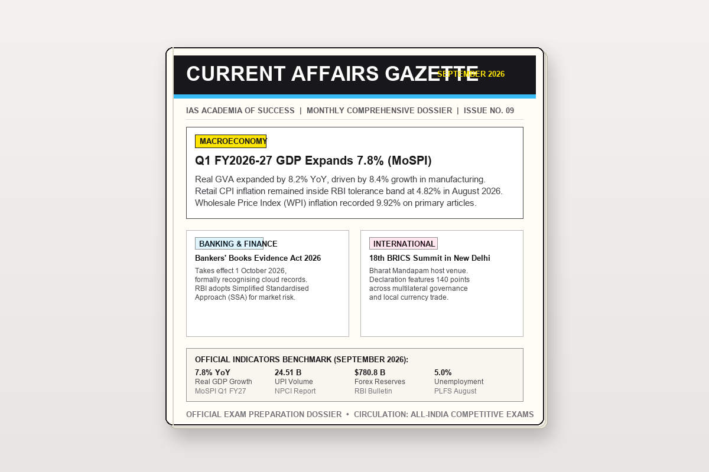

# Current Affairs Gazette

An interactive current-affairs reading and revision platform built for competitive-exam preparation. The project brings monthly current-affairs editions, searchable topic collections, flashcards, quizzes, progress tracking, and printable study material into one web experience.

<p align="center">
  <a href="https://current-affairs-self.vercel.app/"><strong>Open the live application →</strong></a>
  &nbsp;·&nbsp;
  <a href="https://github.com/shouri123/Current-Affairs-2026">View source on GitHub</a>
</p>

<p align="center">
  
</p>

<p align="center">
  
  
  
  
  
</p>

---

## Overview

Current Affairs Gazette is designed to make revision more active than reading a static document. It combines structured monthly editions with tools that help learners discover important updates, test recall, organise revision, and monitor their progress.

The interface follows a playful neo-brutalist visual direction, using a warm paper-like canvas, bold outlines, high-contrast colour accents, and motion-led interactions.

**The application is intended for learners preparing for examinations such as UPSC, Banking, SSC, and State PSCs.**

## Available editions

The current application includes three monthly editions:

| Edition | Issue | Content entries |
| --- | --- | ---: |
| July 2026 | 07/2026 | 116 |
| August 2026 | 08/2026 | 111 |
| September 2026 | 09/2026 | 149 |

The September 2026 edition is organised into 11 subject areas and highlights 81 priority events for focused revision.

## Features

### Explore and organise current affairs
- Browse monthly editions from a single interface.
- Navigate 11 subject areas in the September edition, including Banking, National News, International Affairs, Defence, Sports, Awards, and Appointments.
- Search the collection and narrow results using topic, priority, content type, and available verification-status filters.
- Identify priority updates with Must-Know labels.

### Revise actively
- **Interactive flashcards:** Flip through question-and-answer cards and mark material for review.
- **Quiz modes:** Practise with quick, subject-based, Must-Know, full, and incorrect-question revision modes.
- **Daily revision:** Open a focused daily set containing seven facts and five questions.
- **Pinned facts:** Save important entries to a personal revision list, then copy or export the collection as Markdown study notes.

### Track learning progress
- Mark facts as mastered and monitor completion by topic.
- Keep track of quiz attempts, scores, accuracy, and questions that need another look.
- Persist learning progress in the browser using local storage.

### Interactive learning experience
- Explore clickable SVG data visualisations and fact-detail views.
- Use optional audio cues generated with Tone.js.
- See animated feedback, quiz streaks, and milestone celebrations.
- Print clean, study-friendly layouts or save them as PDF through the browser's print dialog.

### Source transparency
- Content models support source references, issuing authorities, publication dates, and verification metadata.
- The interface includes status labels such as Verified, Needs Review, Disputed, Context Updated, and Source Review.
- Content review is ongoing. A status label should not be treated as a guarantee unless the supporting evidence for that specific claim has been checked.

See the [content accuracy and QA checklist](docs/AUDIT_CHECKLIST.md) for the current review queue and known follow-up work.

## Technology stack

| Technology | Role |
| --- | --- |
| [Next.js 14](https://nextjs.org/) | React framework and App Router |
| [React 18](https://react.dev/) | Component-based user interface |
| [TypeScript](https://www.typescriptlang.org/) | Typed application and content models |
| [Tailwind CSS](https://tailwindcss.com/) | Styling and responsive layout |
| [Radix UI](https://www.radix-ui.com/) | Accessible interaction primitives |
| [GSAP](https://gsap.com/) | Scroll-triggered and timeline-based animations |
| [Framer Motion](https://www.framer.com/motion/) | Component transitions and motion |
| [Tone.js](https://tonejs.github.io/) | Synthesised interface sound effects |
| [canvas-confetti](https://www.npmjs.com/package/canvas-confetti) | Quiz and milestone celebrations |
| [Lucide](https://lucide.dev/) | Interface icons |
| [Vercel](https://vercel.com/) | Hosting and deployment |

## Getting started

### Requirements

- Node.js 18.17 or later (Node.js 20+ recommended)
- npm

### 1. Clone the repository

```bash
git clone https://github.com/shouri123/Current-Affairs-2026.git
cd Current-Affairs-2026
```

### 2. Install dependencies

```bash
npm install
```

### 3. Start the development server

```bash
npm run dev
```

Open [http://localhost:3000](http://localhost:3000) in your browser.

### 4. Run checks

Run the project's content validation and learning-engine tests:

```bash
npm test
```

Create a production build:

```bash
npm run build
npm start
```

## Project structure

The repository is organised around the application interface, reusable interactions, monthly content, and validation scripts.

```text
.
├── public/
│   └── images/                 # Gazette preview assets
├── scripts/                    # Content generation and validation utilities
├── docs/
│   └── AUDIT_CHECKLIST.md       # Content accuracy and QA tracking
├── src/
│   ├── app/                     # Next.js routes, layout, and global styles
│   ├── components/
│   │   ├── interactive/         # Quizzes, flashcards, progress, pins, revision
│   │   ├── layout/              # Navigation, hero, and footer
│   │   ├── sections/            # Subject lists, fact cards, SVG diagrams
│   │   └── ui/                  # Reusable interface primitives
│   ├── data/                    # Monthly editions, questions, and source registry
│   ├── hooks/                   # Local storage, debounce, and sound hooks
│   ├── lib/                     # Shared utilities
│   └── types/                   # Shared TypeScript models
├── tests/                       # Learning-engine and content tests
├── package.json
└── README.md
```

## Deployment

The application is configured for deployment on Vercel.

1. Import the GitHub repository into [Vercel](https://vercel.com/new).
2. Allow Vercel to detect the Next.js project settings.
3. Deploy the project and open the generated deployment URL.

The public deployment is available at [current-affairs-self.vercel.app](https://current-affairs-self.vercel.app/).

## Content and accuracy notes

Current-affairs material can become outdated as events develop. The project therefore maintains a separate QA checklist to track confirmed corrections, context updates, and source-review tasks.

When using the material for exam preparation, open the linked source for important claims and check the latest official update. The presence of a fact in the application does not, by itself, establish that it has been independently re-verified.

## Feedback

Found an issue or have a suggestion? Please open an issue in the [GitHub repository](https://github.com/shouri123/Current-Affairs-2026/issues).

## License

No open-source license is currently provided. All rights reserved © 2026.
