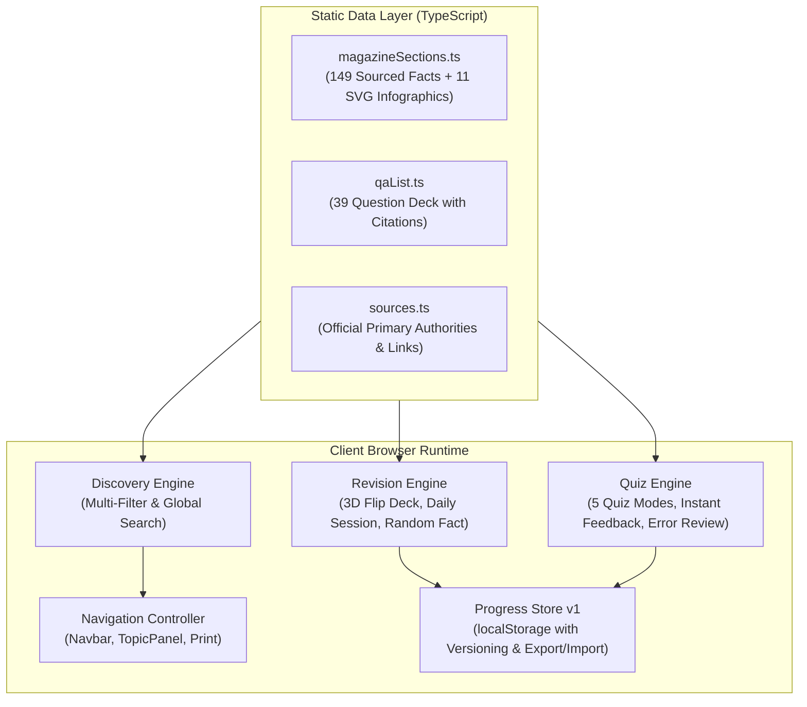

# System Architecture — Current Affairs Gazette
**Architecture Version:** 2.0.0  
**Stack:** Next.js 14 (App Router) + TypeScript + Tailwind CSS + shadcn/ui + Radix UI  
**Target Environment:** Vercel Edge & Serverless Network  

---

## 1. High-Level Architecture Overview

Current Affairs Gazette operates as a high-performance, client-orchestrated educational platform built on Next.js 14. All 149 facts, 39 revision questions, and official sources are compiled into strongly-typed static datasets, enabling instant sub-millisecond search, client-side filtering, and offline-resilient revision without latency or external backend overhead.

---

## 2. Core Subsystems

### A. Discovery Subsystem
- **Instant Search**: Normalized case-insensitive matching across titles, summaries, explanations, claims, and tags.
- **Smart Filter Pipeline**: Composable multi-dimensional filtering applying boolean intersections across:
  1. `category` (11 subjects)
  2. `importance` (`must-know`, `important`, `general`)
  3. `contentType` (`national`, `international`)
  4. `verificationStatus` (`verified`, `needs-review`, `outdated`, `disputed`)

### B. Revision Subsystem
- **3D Interactive Flashcards**: Active-recall deck featuring question on front, answer and official citation on back, with shuffle and progress tally.
- **Deterministic Daily Revision Session**: Uses a date-seeded hash (`YYYY-MM-DD`) to produce a consistent set of 7 Must-Know facts across distinct categories for each day.
- **Random Fact Spotlight**: Modal presentation of random facts with subject filtering and direct source links.

### C. Multi-Mode Quiz Engine
- Configurable quiz orchestrator supporting:
  1. `Quick Revision`: 5 to 10 random questions.
  2. `Subject Test`: Questions filtered to a chosen subject.
  3. `Must-Know Test`: High-priority exam-tested facts only.
  4. `Full Revision`: Randomized test spanning the complete deck.
  5. `Incorrect Answers Review`: Focused re-testing of questions missed in past sessions.
- Generates score summary, accuracy percentage, and full answer review list.

### D. Personal Progress Subsystem
- Persistent, versioned browser storage:
  - Key: `ca_gazette_progress_v1`
  - Tracks: `masteredFactIds`, `pinnedFactIds`, `completedSectionIds`, `quizAttempts`, `incorrectQuestionIds`, `lastStudiedAt`.
  - Migration safety: If storage schema updates, version migrators safely transform existing user data.
  - Export/Import: User can download JSON backup of their progress or restore it across devices.

---

## 3. Security, Grounding & Safety Principles

1. **Client-Side Privacy**: Progress and notes are stored entirely on the candidate's device; no personal information is tracked or transmitted.
2. **Grounded Source Transparency**: Every claim links to an official publisher (PIB, RBI, Ministry of Finance, UN, etc.). No simulated or fake sources.
3. **Resilient Offline Compatibility**: Because data is bundled at build time, the platform continues to function for revision even with spotty connectivity.

