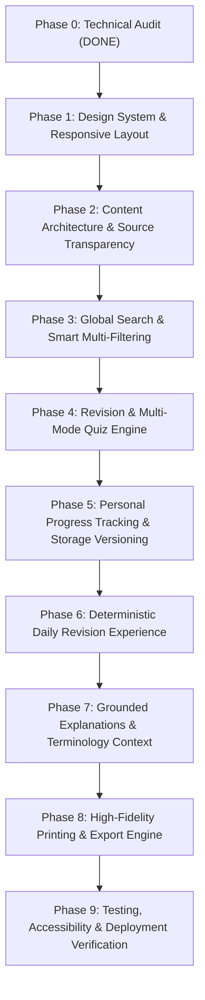

# Implementation Plan — Current Affairs Gazette
**Target Architecture:** Next.js 14 + Tailwind CSS + shadcn/ui + TypeScript  
**Goal:** Transform into an interactive, trustworthy, and personalised revision platform  

---

## Phase Breakdown & Milestone Schedule

---

### Phase 1: Design System & UI/UX Improvements
1. **Preserve Neo-Brutalism**: Retain brand hues (`#38bdf8`, `#FFFDF5`, `#18181B`, `#FFE600`), 1px borders, crisp geometry, and zero brutal offset shadows.
2. **Three-Area Page Structure**:
   - Area A: Sticky Main Navigation (Logo, Search, Revision, Quiz, Daily, Progress, SFX, Pinned).
   - Area B: Main Content Workspace with expandable item explanations, source citations, and yellow highlight chips.
   - Area C: Secondary Topic Navigation Panel (all 11 subjects, item counts, completed count, must-know counts, jump-to-section).
3. **Responsive Testing**: Seamless adaptation across Large Desktop (1536px), Laptop (1024px), Tablet (768px), and Mobile (<640px).

### Phase 2: Content Architecture & Source Transparency
1. **Standardised Schema**: Expand `FactItem` and `MagazineSection` in `src/types/index.ts` with `claims`, `sources`, `verificationStatus`, `eventDate`, and `verificationNotes`.
2. **Official Source Grounding**: Attach primary sources (PIB, RBI, NPCI, MoF, MoD, UN, Booker, Asian Games records) and secondary citations.
3. **Discrepancy Corrections**:
   - Correct Asian Games women's kabaddi final: 37–33 -> **37–34** vs Iran (26 Sep 2026).
   - Clarify Ryanair FY27 forecast: unhedged fuel risk reduction vs Mount Etna cancellations.
   - Update Booker Prize 2026: M. John Harrison won on 9 Nov 2026 for *The End of Everything*.
   - Revise India–New Zealand FTA: entered into force on 20 Oct 2026.
   - Annotate Sagarmala Finance blue bond: maiden issue withdrawn on 28 Sep 2026.
4. **Deliverables**: `docs/CONTENT_SCHEMA.md` and `docs/CONTENT_QUALITY_REPORT.md`.

### Phase 3: Global Search & Smart Filtering
1. **Global Search**: Search titles, summaries, explanations, tags, claims, and numerical facts.
2. **Multi-Dimensional Smart Filters**:
   - Subject (11 categories)
   - Importance (Must-Know, Important, General)
   - Content Type (National, International)
   - Verification Status (Verified, Needs Review, Disputed, Outdated)
3. **Topic Quick Navigation Panel**: Compact sticky/collapsible drawer displaying subject completion percentages and Must-Know tallies.

### Phase 4: Revision & Learning Engine
1. **Interactive Revision Cards (39 Qs)**:
   - Front/Back flip card with question, answer, explanation, subject, importance, and primary source citation.
   - Shuffle, reveal all, mark reviewed, keyboard navigation.
2. **Multi-Mode Quiz Engine**:
   - Quick Revision (5–10 questions)
   - Subject Test (filtered by category)
   - Must-Know Test (exam essentials)
   - Full Revision (full randomized deck)
   - Incorrect Answers Review (focus on past mistakes)
   - Instant feedback, explanation, and accuracy scoring.
3. **Random Fact Generator**: Enhanced with subject filter and direct link to source.

### Phase 5: Personal Progress Tracking
1. **Versioned Storage**: Store `v1` state in `localStorage` (`ca_progress_v1`) tracking completed subjects, mastered facts, quiz history, accuracy, and bookmarks.
2. **Progress Dashboard Modal**:
   - Visual statistics (overall completion, per-subject progress, quiz accuracy, strongest/weakest subjects).
   - Export Progress as JSON, Import Progress, and Reset with confirmation.

### Phase 6: Daily Revision Experience
1. **Deterministic Daily Set**: Deterministic algorithm generating a curated daily mix of 7 Must-Know facts based on current date (`YYYY-MM-DD`).
2. **Follow-Up Daily Quiz**: 5-question test generated from the daily set to solidify retention.

### Phase 7: Grounded Explanations
1. **Fact Deep-Dive Modal**: Structured explanation answering: What happened? Why is it important for examinations? Key terms explained.
2. **Safety Grounding**: Grounded strictly in official release data; zero model hallucination or unverified claims.

### Phase 8: Printing & Export Experience
1. **Dedicated `@media print` Styles**: Hides buttons, audio toggles, and modals.
2. **Print Filter Modes**: Print entire gazette, print active subject, or print Must-Know revision summary.

### Phase 9: Testing, Accessibility & Verification
1. **Automated Validation Script**: `scripts/validate_content.js` to ensure zero missing sources or syntax errors.
2. **Unit & Logic Tests**: Test search, filter combinations, quiz scoring, and storage migrations.
3. **Accessibility**: ARIA labels, semantic markup, high-contrast text, visible focus rings.
4. **Vercel Production Verification**: Build cleanly, push to `master`, and verify deployment on live URL.

